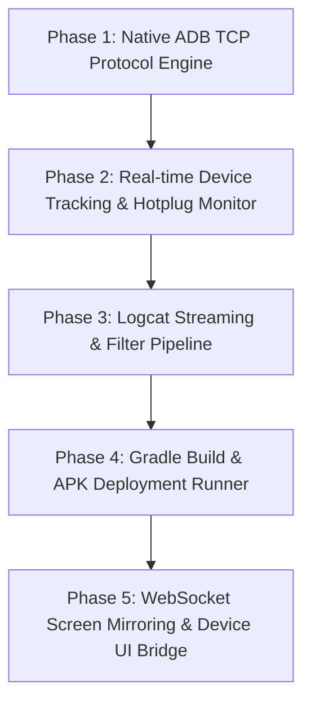

# KELVRA Device Lab (Rust): Standalone USB ADB Bridge & Mobile Runner Plan

> **MANDATORY SCOPE ISOLATION**:
> KELVRA Device Lab is an independent auxiliary subsystem for physical mobile device discovery, ADB protocol bridging, and mobile test automation.
> It must **NOT** be merged into the core `kelvra-bench-v2-rust` repository.
> When ready for Rust migration, it will live in its own dedicated repository and binary crate (`kelvra-device-lab-v2-rust`).

---

## 1. Subsystem Mission & Responsibilities

KELVRA Device Lab provides direct, low-latency communication with physical Android and iOS mobile devices over USB:
1. **Direct USB & ADB Protocol Engine**: Direct TCP socket communication with the Android Debug Bridge server (`127.0.0.1:5037`) eliminating flaky subprocess shells.
2. **Device State Auto-Discovery**: Continuous polling and hotplug detection for USB-connected Android smartphones and tablets (`adb track-devices`).
3. **Logcat & Screen Mirroring Pipeline**: High-speed binary streaming of Android logcat output and H.264 screen frames (`scrcpy` protocol) to the developer UI.
4. **Automated Gradle Build & Deployment**: Automated APK building, signature verification, and silent push-installation onto connected test hardware.
5. **iOS Device Support (via `usbmuxd`)**: Native communication with iOS devices over USB using the `usbmuxd` protocol for app deployment and test execution.

---

## 2. Multi-Phase Rust Execution Blueprint

### Phase 1: Native Rust ADB Protocol Client
- Implement raw socket protocol communication directly to ADB daemon port `5037`.
- Commands: `host:version`, `host:devices-l`, `host:transport:<serial>`, `shell:<command>`, `sync:send`.
- Eliminates Python `subprocess.run(["adb", ...])` process spawn latency and file handle exhaustion on Windows.

### Phase 2: USB Hotplug & Device Discovery Daemon
- Long-running Tokio task listening on `host:track-devices`.
- Instant notification when an Android device is plugged in, authorized, or disconnected over USB.
- Health checks: Check ADB debugging authorization status (`unauthorized` vs `device`) and guide user through USB debugging prompt.

### Phase 3: High-Throughput Logcat Streaming
- Stream raw binary logcat chunks through a lock-free buffer.
- Real-time regex parsing for app crashes, ANRs (Application Not Responding), and Android Jetpack Compose layout errors.

### Phase 4: Gradle Automation & APK Deployment
- Run Gradle builds (`./gradlew assembleDebug`) with progress feedback.
- Stream APK installation directly over ADB sync protocol without copying files to intermediate temp paths.

### Phase 5: Low-Latency Screen Frame Streaming
- Interface with `scrcpy` server jar injected onto the Android device.
- Decode H.264 video frames in Rust and stream to UI via WebSocket / WebRTC.

---

## 3. Recommended Rust Crates

| Domain | Python Reference | Rust Crates |
| :--- | :--- | :--- |
| ADB Socket Client | `subprocess.Popen` | Custom TCP client / `adb_client` |
| USB Protocol | `pyusb` | `rusb`, `nusb` |
| Screen Streaming | `scrcpy-py` | `video-rs`, `tokio-tungstenite` |
| Async Networking | `asyncio` | `tokio`, `axum` |

---

## 4. Multi-Repo Synchronization Protocol
- Independent GitHub Repository: `https://github.com/greninja-op/kelvra-device-lab.git`.
- Monorepo Sync: Changes will be mirrored to `KELVRA.git` and `PLANNING.git`.
