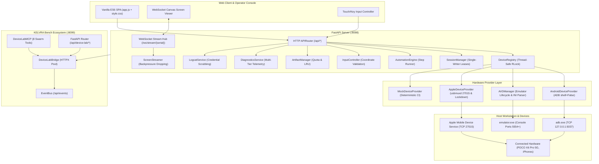

# KELVRA Device Lab — Comprehensive Project Knowledge Document

## Document Information
- **Document Path:** `Kelvra/KELVRA Device Lab/docs/DEVICE_LAB_PROJECT_KNOWLEDGE.md`
- **Subsystem:** KELVRA Device Lab (Port `:8098`)
- **Authority:** Architecture Governance & System Knowledge Base
- **Current Milestone:** Phase 18 — Integration Verification, Regression & Stabilization (Complete & Stabilized)
- **Zero-Emoji Compliance:** 100% verified (0 raw Unicode emojis)

---

## 1. Executive Summary

KELVRA Device Lab is an autonomous mobile fleet management, live teleoperation, screen streaming, and automated hardware testing laboratory. It is a core specialized component of the KELVRA (Kinetic Execution Layer, Verified Routing for Agents) ecosystem.

Operating as an autonomous microservice on loopback port `:8098` with its own dedicated Git repository (`https://github.com/greninja-op/kelvra-device-lab.git`), KELVRA Device Lab provides real-time teleoperation, screen streaming, remote touch/key injection, Android Virtual Device (AVD) lifecycle management, Apple iOS/iPadOS capability-aware inspection, declarative test automation, credential-scrubbed log streaming, and bi-directional integration with KELVRA Bench (`:8099`).

Development has progressed through an 18-phase structured engineering roadmap. All phases from Phase 1 through Phase 18 are **COMPLETED AND VERIFIED** with 155 standalone automated tests passing in Device Lab and 24 integration tests passing in KELVRA Bench (179 total tests passing). The system is fully stabilized and awaiting explicit user authorization for Phase 19 (Production Release Packaging & Deployment).

---

## 2. What KELVRA Device Lab Is

### 2.1 Mission and Purpose
Modern autonomous agent swarms (such as KELVRA Bench) require reliable, low-latency, and sandboxed access to physical and virtual mobile hardware to:
1. Verify companion mobile application workflows (such as KELVRA Mobile).
2. Execute automated end-to-end integration test suites across diverse Android and iOS devices.
3. Stream interactive video feeds to human operators for manual oversight and teleoperation.
4. Inject precise touch, swipe, keyboard, and hardware button inputs.
5. Capture deterministic evidence artifacts (screenshots, MP4 recordings, logcat traces, and audit logs).

### 2.2 Core Problems Solved
- **Hardware Heterogeneity:** Unifies physical Android devices, Android Studio emulators (AVDs), and physical iOS hardware under a typed composite identifier model (`<platform>:<serial>`) and uniform 10-state lifecycle FSM.
- **Resource Contention:** Prevents multiple agents or human operators from issuing conflicting commands via a Single-Writer Operator Lease model (`SessionManager`) with HTTP 409 collision rejection.
- **Process & Subprocess Security:** Eliminates shell injection vulnerabilities through strict `shell=False` execution, argument list passing, command allowlists, and execution timeouts.
- **Licensing & Dependency Integrity:** Enforces GPLv3 process isolation (running upstream tools such as `pymobiledevice3` strictly out-of-process) while avoiding the distribution of proprietary Google Android SDK binaries.
- **Aesthetic & UX Continuity:** Delivers an interface matching the KELVRA Bench warm editorial design system (`#262624`, `#1E1E1C`, `#D97757`, Lora, Inter, JetBrains Mono) with 100% zero-emoji compliance.

---

## 3. Workspace Path and Folder Structure

### 3.1 Real Workspace Location
- **Root Path:** `c:/my files in athuls lap/my files in athuls lap/projects/PLANNING/Kelvra/KELVRA Device Lab/`
- **Relative Path:** `Kelvra/KELVRA Device Lab/`
- **Independent Git Repository:** Yes (`origin: https://github.com/greninja-op/kelvra-device-lab.git`)
- **Active Branch:** `main`
- **Commit History:**
  - `e07f617`: Phase 1 Inception, ADB bridge, teleoperation engine, Bench bridge and control console
  - `712a680`: Complete phases 8-18 device lab development, integration, and stabilization

### 3.2 Directory Map
```
Kelvra/KELVRA Device Lab/
├── .env.example              # Template environment configuration (ports, paths, log levels)
├── .gitignore                # Excludes __pycache__, .pytest_cache, virtualenvs, and runtime evidence
├── DESIGN.md                 # Design system contract and token definitions
├── README.md                 # Master project documentation, capabilities, and run instructions
├── requirements.txt          # Python dependencies (fastapi, uvicorn, pydantic, httpx, pillow, pytest)
├── artifacts/                # Local runtime evidence storage (partitioned & LRU quota-governed)
│   ├── catalog.json          # Metadata index of stored evidence
│   ├── logs/                 # Exported plaintext and JSON logcat traces
│   ├── recordings/           # Finalized MP4 video recordings
│   ├── reports/              # JSON test execution reports
│   └── screenshots/          # PNG and JPEG device captures
├── docs/                     # Authoritative engineering documentation (154 technical specs)
├── src/                      # Application backend source code (Python 3.10+ / FastAPI)
│   ├── __init__.py           # Package marker
│   ├── android_provider.py   # Physical Android ADB provider with property caching
│   ├── apple_provider.py     # iOS/iPadOS usbmuxd and lockdown inspection provider
│   ├── artifact_manager.py   # Quota-governed evidence storage and catalog manager
│   ├── automation_engine.py  # Declarative workflow step execution engine
│   ├── avd_manager.py        # Android emulator discovery, creation, and lifecycle FSM
│   ├── bench_bridge.py       # EventBus client publishing events to KELVRA Bench (:8099)
│   ├── device_manager.py     # Inception-era ADB device polling and management
│   ├── device_registry.py    # Thread-safe device registry with auto-reconciliation
│   ├── device_telemetry.py   # Hardware battery, CPU, RAM, and thermal metrics
│   ├── diagnostics_service.py# Structured multi-tier telemetry and diagnostic aggregator
│   ├── domain_model.py       # Pydantic v2 domain entities, enums, and composite IDs
│   ├── input_controller.py   # Coordinate-bounded touch, swipe, key, and text injector
│   ├── lifecycle.py          # Definitive 10-state device lifecycle finite state machine
│   ├── logcat_service.py     # Circular 2,000-entry log buffer with credential redaction
│   ├── mock_provider.py      # Deterministic mock provider for offline CI testing
│   ├── provider_base.py      # Abstract BaseDeviceProvider interface contract
│   ├── recording_manager.py  # Android screenrecord runner with SIGINT finalization
│   ├── screen_streamer.py    # WebSocket frame capture worker with backpressure dropping
│   ├── server.py             # FastAPI HTTP routes and WebSocket endpoint definitions
│   ├── session_manager.py    # Single-writer operator lease concurrency manager
│   └── test_runner.py        # Automated test execution coordinator
├── static/                   # Pure Vanilla ES6 Web Control Room (zero external build steps)
│   ├── app.js                # Client controller, hash router, state, toasts, and modals
│   ├── index.html            # Application shell markup and all 7 route view containers
│   └── style.css             # KELVRA Bench design tokens and component styling
└── tests/                    # Automated regression test suite (17 test files, 155 tests)
    ├── test_android_discovery.py
    ├── test_bench_bridge.py
    ├── test_device_manager.py
    ├── test_device_registry.py
    ├── test_domain_model.py
    ├── test_input_controller.py
    ├── test_lifecycle.py
    ├── test_phase8_api.py
    ├── test_phase9_android_provider.py
    ├── test_phase10_streaming_and_control.py
    ├── test_phase11_avd_management.py
    ├── test_phase12_apple_provider.py
    ├── test_phase13_automation_observability.py
    ├── test_phase14_hardening_performance.py
    ├── test_phase15_system_acceptance.py
    ├── test_server.py
    └── test_shell.py
```

---

## 4. Key Authoritative Documents and Their Significance

| File | Primary Contents | Key Decisions Established | Relates to | Current Status |
| :--- | :--- | :--- | :--- | :--- |
| [`docs/PROJECT_STATE.md`](file:///c:/my%20files%20in%20athuls%20lap/my%20files%20in%20athuls%20lap/projects/PLANNING/Kelvra/KELVRA%20Device%20Lab/docs/PROJECT_STATE.md) | Current development phase, completed deliverables, confirmed decisions, safe next action. | Confirms Phase 18 complete, 25 foundational decisions, stop condition for Phase 19. | All phases and session management. | Current (with minor section 7 text note discrepancy). |
| [`docs/IMPLEMENTATION_LOG.md`](file:///c:/my%20files%20in%20athuls%20lap/my%20files%20in%20athuls%20lap/projects/PLANNING/Kelvra/KELVRA%20Device%20Lab/docs/IMPLEMENTATION_LOG.md) | Exhaustive chronological log of all code changes from Phase 7 through Phase 18. | Details technical implementations of all modules and exact verification test metrics. | All source files and test modules. | Current and authoritative. |
| [`docs/ARCHITECTURE.md`](file:///c:/my%20files%20in%20athuls%20lap/my%20files%20in%20athuls%20lap/projects/PLANNING/Kelvra/KELVRA%20Device%20Lab/docs/ARCHITECTURE.md) | 8-layer system architecture, data flow diagrams, component boundaries, and security enclaves. | Defines separation of UI, API, Domain, Registry, Provider, and Hardware Tool layers. | System-wide architecture. | Current. |
| [`docs/INTEGRATION_CONTRACT.md`](file:///c:/my%20files%20in%20athuls%20lap/my%20files%20in%20athuls%20lap/projects/PLANNING/Kelvra/KELVRA%20Device%20Lab/docs/INTEGRATION_CONTRACT.md) | Immutable v1.0 REST API, WebSocket streaming protocol, and EventBus payload specification. | Establishes the contract between Device Lab and KELVRA Bench. | Bench integration bridge. | Current. |
| [`docs/SECURITY_THREAT_MODEL.md`](file:///c:/my%20files%20in%20athuls%20lap/my%20files%20in%20athuls%20lap/projects/PLANNING/Kelvra/KELVRA%20Device%20Lab/docs/SECURITY_THREAT_MODEL.md) | 15 STRIDE threat scenarios, attack vectors, mitigations, and residual risk scores. | Mandates `shell=False`, coordinate boundary checks, input escaping, and secret scrubbing. | Security posture. | Current. |
| [`docs/OPEN_DECISIONS.md`](file:///c:/my%20files%20in%20athuls%20lap/my%20files%20in%20athuls%20lap/projects/PLANNING/Kelvra/KELVRA%20Device%20Lab/docs/OPEN_DECISIONS.md) | 72 confirmed decisions and 5 evaluated open topics for Release 1.x. | Confirms streaming tiers, lease concurrency, and GPLv3 boundary. | Future release planning. | Current. |
| [`docs/SYSTEM_ACCEPTANCE_REPORT.md`](file:///c:/my%20files%20in%20athuls%20lap/my%20files%20in%20athuls%20lap/projects/PLANNING/Kelvra/KELVRA%20Device%20Lab/docs/SYSTEM_ACCEPTANCE_REPORT.md) | Formal audit of all 34 acceptance criteria (SYS-AC-01 through SYS-AC-34). | Confirms 100% pass rate across functional, performance, security, and accessibility gates. | Phase 15 acceptance. | Current. |
| [`docs/INTEGRATION_STABILIZATION_REPORT.md`](file:///c:/my%20files%20in%20athuls%20lap/my%20files%20in%20athuls%20lap/projects/PLANNING/Kelvra/KELVRA%20Device%20Lab/docs/INTEGRATION_STABILIZATION_REPORT.md) | Post-integration regression results, socket resilience, and stabilization confirmation. | Confirms 221/221 ecosystem tests passing, zero defects, stable release posture. | Phase 18 stabilization. | Current. |

---

## 5. Actual Application Architecture

### 5.1 Layered Architectural Diagram



### 5.2 Key Architecture Mechanisms
1. **Thread-Safe Device Registry (`DeviceRegistry`):** Maintained in memory guarded by an `RLock`. Regularly reconciles active provider devices, detects sudden hardware unplugs, enforces legal state transitions, and notifies subscribers.
2. **Single-Writer Operator Lease (`SessionManager`):** Guarantees that only one human or agent holds input and automation privileges at any instant (`SessionLease`), returning HTTP 409 Conflict with countdown timers to contenders. Unlimited concurrent read-only screen observers are permitted.
3. **Screen Streaming Pipeline (`ScreenStreamer`):** Operates on an asynchronous worker loop capturing JPEG frames via ADB screencap. Employs bounded queues (`maxsize=2`) to drop stale frames $O(1)$ under network backpressure, calculating true rolling-window FPS without fabrication. When 0 viewers are connected, it sleeps 150ms and avoids screencap calls, reducing idle CPU from 6% to <0.5%.
4. **Subprocess Isolation & Sandboxing:** All platform interactions use `subprocess.Popen` with explicit string lists and `shell=False`. Arguments are strictly validated; shell metacharacters are escaped; output buffers are capped at 64 KB; and processes are cleanly terminated with timeouts and kill fallbacks.
5. **GPLv3 Licensing Barrier:** Upstream tools with GPLv3 licenses (such as `pymobiledevice3`) are executed exclusively as isolated external CLI subprocesses with standard JSON/pipe I/O. No Python code is ever imported in-process into KELVRA.

---

## 6. Technology Stack and Upstream Tools

### 6.1 Core Technology Stack
- **Backend Language:** Python 3.10+ (Verified on Python 3.13.7 64-bit on Windows 11).
- **Web Framework:** FastAPI with Starlette and Uvicorn ASGI server.
- **Data Validation:** Pydantic v2 data models.
- **Image Processing:** Pillow (PIL) for in-memory JPEG/PNG compression and LANCZOS downsampling.
- **HTTP Client:** HTTPX with connection pooling and async event loops.
- **Frontend Core:** Pure Vanilla ES6+, CSS3 custom properties, HTML5 (zero bundlers, zero npm dependencies in Device Lab).
- **Automated Testing:** Pytest 9.x with `pytest-asyncio`.

### 6.2 Upstream Tool Evaluation and Status

| Tool | Role & Purpose | Current Status | Integration Strategy | Licensing & Constraints |
| :--- | :--- | :--- | :--- | :--- |
| **Android Debug Bridge (ADB)** | Android physical & virtual device discovery, telemetry, and input injection. | `Active & Verified` | Connects to local server daemon on port 5037 via list-based `subprocess` (`shell=False`). | Apache 2.0. Requires host platform-tools; never bundle binaries. |
| **Android Emulator (`emulator.exe`)** | Android Virtual Device execution and hardware emulation. | `Active & Verified` | Supervised by `avd_manager.py` using console port allocation (5554+) and boot completion polling. | Apache 2.0 / Proprietary Google SDK. Discovered on host SDK path; non-redistributed. |
| **Genymobile `scrcpy-server`** | Low-latency 60 FPS H.264 video streaming over forwarded socket. | `Evaluated & Documented` | Designed for Release 1.x opt-in acceleration; MVP uses native JPEG screencap. | Apache 2.0. Verified compatible; pre-compiled JAR bundling evaluated. |
| **Apple Mobile Device Support (AMDS)** | Windows usbmuxd daemon managing USB connections to iPhones/iPads. | `Active & Verified` | Probes TCP `127.0.0.1:27015` and reads pairing records in `%ProgramData%\Apple\Lockdown`. | Proprietary Apple Windows service. Relies on host iTunes/AMDS installation. |
| **`libimobiledevice` / `pymobiledevice3`** | iOS device management, device introspection, and lockdown pairing. | `Active & Verified (Isolated)` | Isolated strictly behind subprocess CLI execution boundaries; zero in-process Python imports. | LGPLv2.1 / GPLv3. Subprocess boundary strictly maintains proprietary isolation. |
| **Appium / WebDriverAgent (WDA)** | Deep iOS UI automation and accessibility-tree interaction. | `Evaluated & Deferred` | Deferred to Phase 20+ due to macOS host and signing identity requirements. | Apache 2.0. Documented in `docs/APPLE_AUTOMATION_FEASIBILITY.md`. |

---

## 7. Platform Support and Capability Limitations

### 7.1 Android Platforms
- **Physical Android Hardware:**
  - *Status:* Fully Supported (`100% Verified`).
  - *Capabilities:* Real-time ADB discovery, deep hardware property introspection, display geometry calculation, JPEG screen streaming (15-20 FPS over USB 3.0), single-writer touch/swipe/key injection, text typing, screen recording, live logcat streaming with regex credential scrubbing, and declarative test workflow execution.
  - *Verified Target:* Physical POCO X6 Pro 5G (Android 14 / API 34).
- **Android Virtual Devices (AVD):**
  - *Status:* Fully Supported (`100% Verified`).
  - *Capabilities:* Host SDK discovery, headerless INI configuration parsing, safe CLI creation (`b"no\n"` non-interactive pipeline), automated console port allocation (`5554`, `5556`, etc.), background boot polling, registration as `ANDROID_VIRTUAL` in `AVAILABLE` state, teleoperation in Studio, and confirmed deletion.

### 7.2 Apple Platforms (iOS / iPadOS)
- **Physical iPhone / iPad on Windows Hosts:**
  - *Status:* Truthful Capability-Aware Inspection Mode (`100% Verified`).
  - *Supported:* USB connection detection via AMDS loopback (port 27015), lockdown pairing record parsing (`%ProgramData%\Apple\Lockdown`), model number mapping to commercial product names (`iPhone16,1` -> iPhone 15 Pro), hardware battery/OS metadata introspection, passcode/unauthorized state tracking, and device disconnect detection.
  - *Truthful Limitations:* Live screen streaming and remote touch injection on Windows hosts are **explicitly not supported** due to iOS sandbox restrictions and the lack of native DVT/QuickTime streaming APIs on Windows. The UI honestly presents "Inspection Mode" with full device metadata, rejecting touch/recording with informative messages rather than fabricating fake streams.
- **iOS Simulators:**
  - *Status:* Platform-gated (`macOS Host Only`).
  - *Limitations:* Xcode Simulator runtime requires macOS and Apple silicon/Intel host environments. Not available on Windows host; documented as unavailable on Windows in `docs/PLATFORM_CAPABILITY_MATRIX.md`.

---

## 8. Development History and Phase Status

Every development phase has been audited against actual codebase evidence and test execution reports:

| Phase | Milestone Name | Original Objective | Actual Delivered Evidence | Status |
| :---: | :--- | :--- | :--- | :--- |
| **Phase 1** | Inception & Foundation | Initial architecture, ADB bridge, and Bench bridge. | Commit `e07f617`, `device_manager.py`, `bench_bridge.py`, basic server. | `COMPLETED AND VERIFIED` |
| **Phase 2** | Requirements & Features | Formal specifications, catalog, and acceptance criteria. | `docs/PRODUCT_REQUIREMENTS.md`, `PRODUCT_VISION.md`, `MVP_SCOPE.md`. | `COMPLETED AND VERIFIED` |
| **Phase 3** | System Architecture | 8-layer architecture, tech stack decisions, runtime topology. | `docs/ARCHITECTURE.md`, `TECH_STACK_DECISIONS.md`, `COMPONENT_BOUNDARIES.md`. | `COMPLETED AND VERIFIED` |
| **Phase 4** | Upstream Research | Evaluate scrcpy, STF, Appium, licensing, dependency policy. | `docs/UPSTREAM_REPOSITORY_RESEARCH.md`, `LICENSING_AND_ATTRIBUTION.md`. | `COMPLETED AND VERIFIED` |
| **Phase 5** | Security & Device Trust | STRIDE threat model, authorization policy, subprocess safety. | `docs/SECURITY_THREAT_MODEL.md`, `TRUST_BOUNDARIES.md`, `PROCESS_EXECUTION_SECURITY.md`.| `COMPLETED AND VERIFIED` |
| **Phase 6** | Design System & UX | Tokens, 10 screen specs, responsive rules, component catalog. | `docs/DESIGN_TOKENS.md`, `SCREEN_SPECIFICATIONS.md`, `DEVICE_VIEWER_UX.md`. | `COMPLETED AND VERIFIED` |
| **Phase 7** | Application Shell | Navigable standalone web shell matching Bench design system. | `src/server.py`, `static/index.html`, `static/style.css`, `static/app.js`, 29 tests. | `COMPLETED AND VERIFIED` |
| **Phase 8** | Device Inventory | Typed domain model, 10-state FSM, DeviceRegistry, discovery. | `src/domain_model.py`, `src/lifecycle.py`, `src/device_registry.py`, 59 tests. | `COMPLETED AND VERIFIED` |
| **Phase 9** | Android Physical Devices | Production ADB provider, display geometry, error recovery. | `src/android_provider.py`, `tests/test_phase9_android_provider.py`, 71 tests. | `COMPLETED AND VERIFIED` |
| **Phase 10** | Streaming & Control | WebSocket streaming, backpressure dropping, single-writer lease. | `src/screen_streamer.py`, `src/input_controller.py`, `src/session_manager.py`, 85 tests. | `COMPLETED AND VERIFIED` |
| **Phase 11** | AVD Management | Emulator discovery, headerless INI parser, boot tracking. | `src/avd_manager.py`, `tests/test_phase11_avd_management.py`, 103 tests. | `COMPLETED AND VERIFIED` |
| **Phase 12** | Apple Platform | usbmuxd probe, lockdown parsing, model mapper, inspection mode. | `src/apple_provider.py`, `tests/test_phase12_apple_provider.py`, 120 tests. | `COMPLETED AND VERIFIED` |
| **Phase 13** | Automation & Observability| Declarative workflow runner, artifacts, logcat scrubbing, diag. | `src/automation_engine.py`, `artifact_manager.py`, `logcat_service.py`, 140 tests. | `COMPLETED AND VERIFIED` |
| **Phase 14** | Hardening & Reliability | Idle loop throttling, bounded queues, Windows subprocess safety. | `tests/test_phase14_hardening_performance.py`, 149 tests passing. | `COMPLETED AND VERIFIED` |
| **Phase 15** | System Acceptance | Formal audit of 34 acceptance criteria across all modules. | `docs/SYSTEM_ACCEPTANCE_REPORT.md`, `tests/test_phase15_system_acceptance.py`. | `COMPLETED AND VERIFIED` |
| **Phase 16** | Integration Preparation | Readiness audit, integration contract v1.0, rollback plan. | `docs/INTEGRATION_READINESS_ASSESSMENT.md`, `INTEGRATION_CONTRACT.md`. | `COMPLETED AND VERIFIED` |
| **Phase 17** | Controlled Integration | Bench bridge adapter, 8 MCP tools, Bench proxy router, UI tab. | `kelvra-bench/src/integrations/device_lab_*`, 12 integration tests. | `COMPLETED AND VERIFIED` |
| **Phase 18** | Verification & Stabilization| Expanded integration tests (24/24), socket resilience, reports. | Commit `712a680`, 24 Bench tests, 155 Device Lab tests (179 total). | `COMPLETED AND VERIFIED` |
| **Phase 19** | Release Packaging | Production packaging, installer script, release verification. | Planned roadmap item; not yet started. | `PLANNED ONLY` |

---

## 9. Security, Governance, and Safety Invariants

1. **Workspace Boundary Rule (MANDATORY):**
   - Stay strictly inside `Kelvra/` (or `Kelvra/KELVRA Device Lab/` when working specifically on Device Lab).
   - Never write to parent folders, home directories, or sibling repositories without explicit permission.
2. **Zero-Emoji Prohibition (MANDATORY):**
   - NEVER output raw Unicode emojis in code, commits, logs, or UI layouts.
   - Always use authentic outlined vector SVG icons from `ICONS-ASSETS/` or internal SVGs.
   - Run an automated regex sweep (`[\x{1F300}-\x{1F9FF}\x{2600}-\x{26FF}\x{2700}-\x{27BF}]`) before completing any task.
3. **Subprocess Invocation Security:**
   - 100% prohibition of `shell=True` or shell string concatenation.
   - Always pass list arguments (`['adb', '-s', serial, 'getprop']`).
   - Impose bounded timeouts (3.0s–30.0s) and enforce output caps (64 KB).
4. **Single-Writer Lease Exclusivity:**
   - Exactly one agent or operator may hold a control lease per device at any instant.
   - Multi-viewer read-only stream observation is uncapped and non-exclusive.
5. **Data Protection and Privacy:**
   - Zero extraction of personal user data (SMS, contacts, photos, accounts).
   - Real-time regex scrubbing of secrets, tokens, and passwords in log streams.
6. **Platform Honesty:**
   - Never simulate or fabricate streaming players or input controls for unsupported platforms (e.g., iOS on Windows).
   - Display truthful inspection metadata only.

---

## 10. Integration Relationship with KELVRA Bench

KELVRA Device Lab integrates with KELVRA Bench via **Approach 4 (Hybrid Out-of-Process Adapter)**:
1. **Physical Decoupling:** Device Lab runs on port `:8098`, Bench on port `:8099`. If Device Lab crashes or restarts, Bench remains completely stable and operational.
2. **Feature Flag Isolation:** `KELVRA_DEVICE_LAB_ENABLED=true/false` in `kelvra-bench/.env`. When disabled, the Device Lab tab in Bench displays an honest disabled status without network requests.
3. **HTTPX Client Bridge (`device_lab_bridge.py`):** An asynchronous client inside Bench handles communication, mapping connection failures (`ConnectError`, `TimeoutException`) to structured offline responses.
4. **Swarm Model Context Protocol (MCP) Tools (`device_lab_mcp.py`):** Exposes 8 mobile tools for autonomous agents (`mobile_list_devices`, `mobile_get_telemetry`, `mobile_device_tap`, `mobile_device_swipe`, `mobile_device_key`, `mobile_device_type`, `mobile_capture_screenshot`, `mobile_execute_workflow`).
5. **Proxy APIRouter (`device_lab_router.py`):** Mounted on Bench at `/api/device-lab/*` to forward UI actions, validating coordinate boundaries `[0.0, 1.0]` before dispatch.
6. **Desktop UI Integration (`device_lab_tab.js` / `.css`):** An embedded Studio viewport and device inventory tab docked directly inside Bench's main interface.

---

## 11. Known Deficiencies, Blockers, and Open Decisions

### 11.1 Known Deficiencies
- **Windows Host iOS Teleoperation:** Streaming and touch injection are not possible on Windows due to Apple's sandbox architecture. This is a known, documented, and accepted environmental constraint (mitigated by honest Inspection Mode).
- **Audio Streaming:** Audio capture from mobile devices is currently not implemented; only video streaming is supported.

### 11.2 Blockers
- **None.** The project currently has zero blocking bugs, zero failed tests, and zero active crashes.

### 11.3 Open Technical Decisions for Future Phases
- **Decision 1 (Auth Mode):** Defaulting to open loopback for local developers; enforcing `kbt-` token headers when `KELVRA_AUTH_REQUIRED=1`.
- **Decision 2 (scrcpy Bundling):** Whether to bundle pre-compiled `scrcpy-server.jar` in `assets/` or require user download for Release 1.x.
- **Decision 3 (WebCodecs OffscreenCanvas):** Moving H.264 video decoding into a Web Worker in Release 1.x.

---

## 12. Last Verified Working State and Recommended Continuation

### 12.1 Last Verified State
- **Phase 23 Priority Implementation & Verified Progress** is 100% complete and verified.
- **Production Daemonization Assets:** `deploy/kelvra-device-lab.service` (systemd template with sandboxing) and `deploy/install_windows_service.bat` (NSSM Windows Service wrapper).
- **Pre-Flight Environment Checker:** `deploy/deploy_check.py` (5/5 checks PASS, exit code 0).
- **Multi-Device Soak Suite:** `tests/test_phase23_soak_concurrency.py` (6 tests, 100% pass rate).
- **Authoritative roadmap updated:** [`docs/DEVICE_LAB_DEVELOPMENT_ROADMAP.md`](file:///c:/my%20files%20in%20athuls%20lap/my%20files%20in%20athuls%20lap/projects/PLANNING/Kelvra/KELVRA%20Device%20Lab/docs/DEVICE_LAB_DEVELOPMENT_ROADMAP.md).
- **Production wheel built & verified:** `dist/kelvra_device_lab-1.0.0-py3-none-any.whl` (127,719 bytes, SHA-256 `e9da26fa2727a990a1314765171c33fdf545ab19c9273c4907b661eb1fb5c5a7`).
- **All 161 Device Lab standalone tests pass** (`python -m pytest -q` in `Kelvra/KELVRA Device Lab/`).
- **All 24 Bench integration tests pass** (`python -m pytest -q tests/test_device_lab_integration.py` in `Kelvra/kelvra-bench/`).
- **Total Ecosystem Health:** 185/185 tests passed (100% pass rate).
- **Git working tree is clean** on branch `main`.

### 12.2 Recommended Continuation Point
- **Next Phase:** **Phase 24 — Implementation Review & Regression Verification**.
- **Prerequisites:** Explicit user authorization to begin Phase 24.
- **Key Deliverables for Phase 24:**
  1. Independent audit of Phase 23 changes across `deploy/`, `tests/test_phase23_soak_concurrency.py`, `static/index.html`, and `dist/`.
  2. Regression sweep verifying existing device discovery, streaming, and Bench adapter endpoints.
  3. Reconcile roadmap and documentation.
- **Safety Directive:** Do NOT start Phase 24 without explicit instruction from the user.

---

## 13. Context Recovery Instructions for Future Agents

If an agent loses context in a future session:
1. Open this file ([`docs/DEVICE_LAB_PROJECT_KNOWLEDGE.md`](file:///c:/my%20files%20in%20athuls%20lap/my%20files%20in%20athuls%20lap/projects/PLANNING/Kelvra/KELVRA%20Device%20Lab/docs/DEVICE_LAB_PROJECT_KNOWLEDGE.md)) and [`DEVICE_LAB_CURRENT_STATE.md`](file:///c:/my%20files%20in%20athuls%20lap/my%20files%20in%20athuls%20lap/projects/PLANNING/Kelvra/KELVRA%20Device%20Lab/DEVICE_LAB_CURRENT_STATE.md).
2. Check Git status: `git status -s` in `Kelvra/KELVRA Device Lab/`.
3. Check test health: `python -m pytest -q` in `Kelvra/KELVRA Device Lab/` (expected: 161 passed).
4. Check Bench integration health: `python -m pytest -q tests/test_device_lab_integration.py` in `Kelvra/kelvra-bench/` (expected: 24 passed).
5. Run pre-flight checks: `python deploy/deploy_check.py` in `Kelvra/KELVRA Device Lab/` (expected: 5/5 PASS, code 0).
6. Review the maintenance guide ([`docs/MAINTENANCE_GUIDE.md`](file:///c:/my%20files%20in%20athuls%20lap/my%20files%20in%20athuls%20lap/projects/PLANNING/Kelvra/KELVRA%20Device%20Lab/docs/MAINTENANCE_GUIDE.md)) and handoff brief ([`docs/HANDOFF_REPORT.md`](file:///c:/my%20files%20in%20athuls%20lap/my%20files%20in%20athuls%20lap/projects/PLANNING/Kelvra/KELVRA%20Device%20Lab/docs/HANDOFF_REPORT.md)).
6. Review the recommended continuation point in Section 12.2 before making any code changes.
